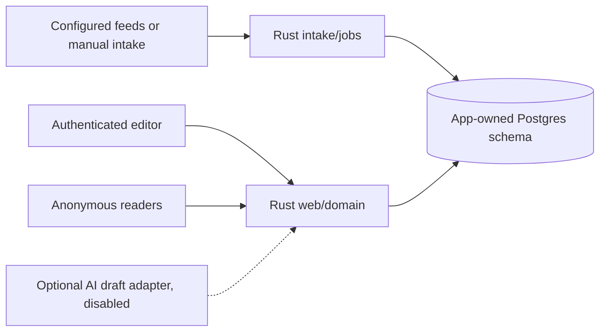

# ADR 0001: an independent Rust newspaper

Status: selected for implementation within roadmap #1; no live cutover authorised.
Related issues: #4, #10–#17, #23, #49.

## Context

The deployed-source frontend reads Postgres directly; Rust services are mocks.
The user requested a full Rust project, Jarvis independence and better article
lengths. Maintaining three network services would add failure modes without
an implemented reason for separate deployments.

## Decision

Use one Cargo workspace with domain, persistence and web modules; a worker can
be a separate binary sharing domain/persistence code. Default to Axum for HTTP,
SQLx/Postgres for persistence and Askama for escaped HTML templates. CSS/HTML
remain ordinary static assets. Full Rust means no required Node runtime/build
and no required AI/Jarvis service; it does not mean rewriting Postgres in Rust.

Axum/Tokio already exist in this repository. SQLx and Askama are prospective
dependencies to verify for maintenance, license and security at introduction.
SQLx provides typed mapping/migrations; Askama suits mostly server-rendered
content. Leptos/WASM is unnecessary for a language toggle and local preferences.
GraphQL would duplicate internal service calls without an identified client.

The application owns versioned migrations, sources, drafts, immutable revisions,
citations, translations, stable threads and edition snapshots. Public read
models contain published data only. Web/editing actions call domain services,
not a second internal HTTP API. Jobs initially use Postgres with transactional
claims/idempotent handlers; a broker needs a later measured justification.

## Publication and compatibility contract

Intake -> draft -> review -> publish -> correct/withdraw works manually without
any provider. Fetching does not publish. AI output is untrusted draft material;
credentials/data sharing/costs require explicit setup. No automatic publication.
Source count measures outlets; origin count measures independent reporting.

Preserve `/`, `/edition/:date`, `/story/:id`, `/archive`, `/recherche?q=...`,
`/sujets`; preserve legacy IDs or issue deterministic redirects. Admin is protected.
Return explicit invalid/not-found/unavailable results, with no SQL/secret leakage.
Use UTC instants; publication-date grouping defaults to Europe/Brussels and is
an explicit setting, not the host timezone.

## Jarvis handoff

Keep legacy provenance and original content. First implement isolated schema,
idempotent import and manual publishing. Prove publication with no Jarvis
configuration/network. Prepare final import/writer-freeze/rollback procedure;
stopping a live writer and switching reader traffic are separate authorised
release actions. Removing reader links must not rewrite historical authorship.

## Consequences and alternatives

One application is simpler to operate and test; workers can still scale separately.
SSR favours accessibility and minimal client code but is less suitable for a future
complex collaborative editor; revisit with evidence. Keep Next during migration;
remove it only after parity and recovery checks. A clean schema requires a
legacy adapter, not a speculative in-place migration of unknown tables.

## Verification and rollback

Trace intake -> review -> edition -> article -> citations in local integration
tests, plus legacy ID mapping and correction snapshots. Build/start without Node
or external provider credentials. Keep the current app/schema available until
cutover evidence exists. Application rollback cannot undo arbitrary data migration;
schema compatibility and backups require explicit release checks.
