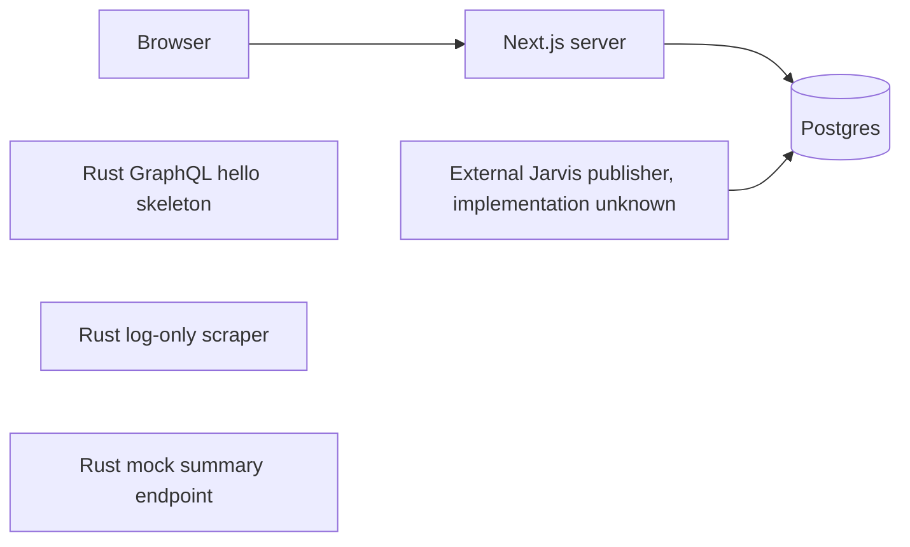

# Current application baseline

Inspected commit: `d67dc5948efd89615706c571e4f26090fac82b71`.
This is source evidence, not a claim about the live homelab. Related issue: #2.

Only Postgres and Next.js are defined in `docker/docker-compose.yml`. No code
connects the Rust services to that path. The external publisher is identified by
comments in `frontend/src/lib/news.ts`; its code and deployed access are unknown.
Database queries run in server components, not in the browser.

## Public and administrative routes

| Route | Implementation under `frontend/src/app/` | Current behaviour | Migration disposition |
| --- | --- | --- | --- |
| `/` | `page.tsx`, `Edition.tsx` | Most recent edition; origin count determines lead | Preserve URL; editorial lead selection replaces ranking |
| `/edition/[date]` | `edition/[date]/page.tsx` | Day's rows and adjacent nonempty dates | Preserve URLs; validate dates, snapshot revisions |
| `/story/[id]` | `story/[id]/page.tsx`, `StoryReader.tsx` | Body, FR/original toggle, disagreements, sources, related-day links | Preserve IDs and functionality; explicit 404/error states |
| `/archive` | `archive/page.tsx` | All edition dates grouped by month | Preserve URL; add pagination |
| `/recherche` | `recherche/page.tsx` | French full-text search, title ILIKE fallback | Preserve URL and `q` parameter; indexed multilingual search |
| `/sujets` | `sujets/page.tsx` | Recent stories with cross-day related IDs | Preserve URL; one head per stable thread |
| `/admin` | `admin/page.tsx` | Read-only status and up to 200 stories; no in-repo auth | Protect before adding editorial mutations |

All pages are force-dynamic. `layout.tsx` incorrectly declares English for the
largely French UI. Theme query parameters are `paper`, `density`, `font`, and
`masthead`; story pages have a client-side original-language toggle.

## Database contract inferred from queries

`frontend/src/lib/news.ts` is the entire database access layer. It assumes:

- `published_stories`: `id`, `title`, `body`, `lang`, `title_fr`, `body_fr`,
  `topic`, `origin_count`, `source_count`, `synthesized`, `claims_json`,
  `disagreements_json`, `disagreements_fr`, `sources_json`, `edition_date`,
  `related_ids`, `updated_at`.
- `news_status`: singleton `id = 1`, `stats`, `updated_at`.

Column types, constraints, indexes, nullability, row counts, publisher transaction
semantics and actual schema versions are **unknown**. JSON/array casts in SELECTs
suggest types; they do not establish DDL. There are no committed migrations.

| Query helper | Reads and behaviour |
| --- | --- |
| `getStories` | Up to 40 rows by origins/recency; currently unused by pages |
| `latestEditionDate` | Maximum edition date |
| `getEdition` | All stories for one date, unbounded |
| `adjacentEditions` | Maximum previous/minimum following nonempty date |
| `getThread` | Related IDs plus current story, sorted by date |
| `searchStories` | Up to 30 French vector matches; title-only fallback |
| `activeThreads` | Cross-day relations; ineffective per-thread deduplication |
| `editionDates` | All edition dates and counts, unbounded |
| `getStatus` | External publisher's singleton status snapshot |
| `getAdminStories` | Up to 200 rows by recency |
| `getStory` | One ID |

Every helper currently catches all database errors and returns an empty result.
Do not preserve this failure behaviour. Preserve source/origin distinctions,
original-language text, translation availability and original source links.

## Configuration and service inventory

| Setting | Current owner/default | Target |
| --- | --- | --- |
| `DATABASE_URL` | Next server; embedded local credentials fallback | Required server configuration; separate reader/writer privileges |
| `NEXT_PUBLIC_JARVIS_URL` | Private LAN fallback, emitted reader links | Retire reader coupling; preserve legacy provenance |
| `NEWS_PAPER`, `NEWS_DENSITY`, `NEWS_FONT`, `NEWS_MASTHEAD` | Next theme helpers | Typed presentation configuration |
| `NODE_ENV`, `PORT`, `HOSTNAME` | Standalone Node image | Transitional only |
| Postgres bootstrap variables | Compose/manifests | Environment-specific secret injection |

Compose maps frontend `3012:3000` and database `5433:5432`; Postgres 18 uses a
named volume at `/var/lib/postgresql`. Rust gateway binds `0.0.0.0:8000`, serves
`/`, `/graphql` (hello only), `/graphiql`; AI binds loopback `127.0.0.1:9000`,
serves `/` and mock `POST /process`; scraper logs every 60 seconds. Rust URLs
are development skeleton endpoints, not required public compatibility contracts.

## Deployment evidence and risks

- `.github/workflows/deploy.yml`: push to main runs Compose down/build/up and
  Docker pruning on a self-hosted runner.
- `.github/workflows/deploy-selfhosted.yml`: the same trigger deploys selected
  frontend/AI changes using `scripts/deploy.sh`; API/scraper filters have no jobs.
- That script expects nonexistent backend Dockerfile paths and uses namespace
  `default`; most `k8s/` manifests use `world-news` and placeholder registry images.
- Frontend/gateway deployment manifests are duplicated. Gateway references a
  service account with no definition. Database uses `emptyDir` in Kubernetes.
- API/AI image checks call an uninstalled curl; scraper ignores `--healthcheck`.

Do not run these deploy scripts during discovery. Their presence does not prove
which stack is deployed. Source changes must first be tested in disposable stacks.

## Read-only production discovery, only when access is authorised

Obtain schema-only metadata using `pg_dump --schema-only --no-owner --no-privileges`
or `information_schema`, counts/oldest/latest dates, migration metadata if any,
and publisher ownership/last successful writes. Keep exports out of Git and chat.
Inspect the authorised host's running Compose project or Kubernetes namespace
and storage metadata without applying/restarting anything. Ask for environment
access through the supported settings flow; never request passwords in chat.

## Compatibility fixtures

`fixtures/legacy-stories.json` contains invented articles under `.invalid` source
domains. It covers original/translated text, partial/null fields, common reporting
origins, corrections and overlapping/missing relationships. It is a behavioural
contract for import tests, **not** an asserted production schema or full news feed.
